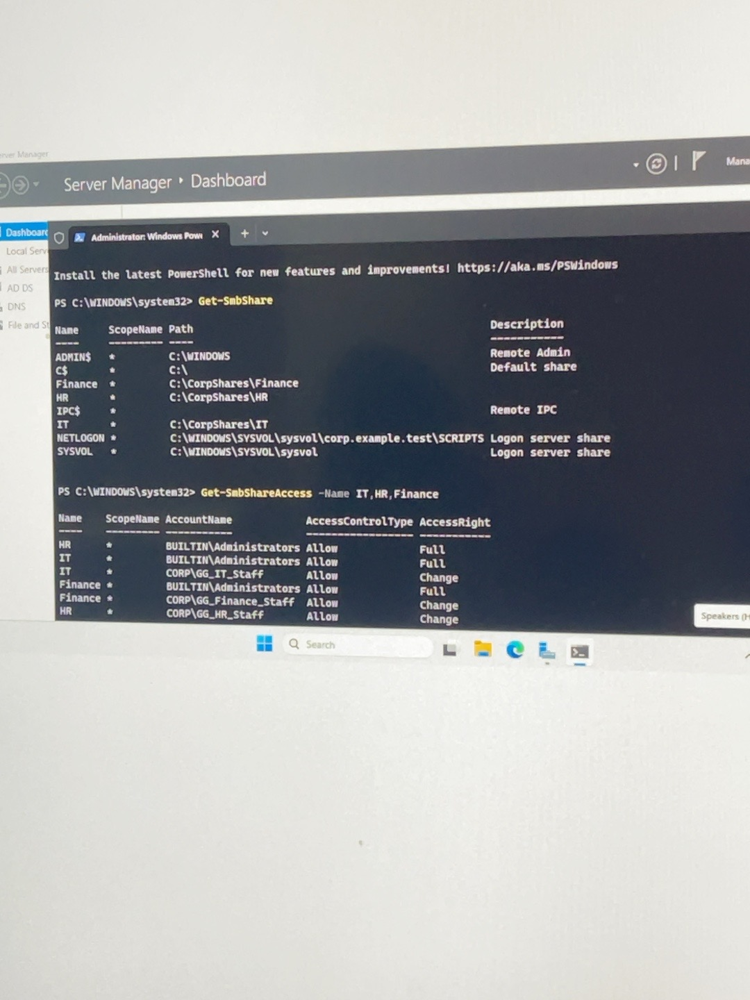
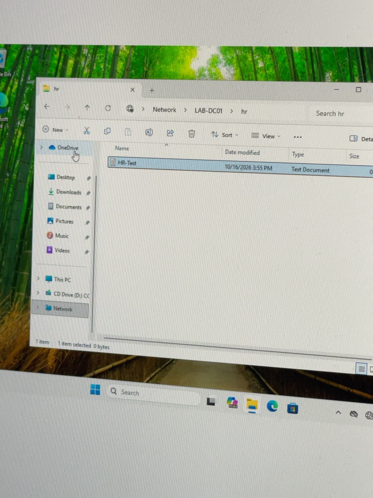
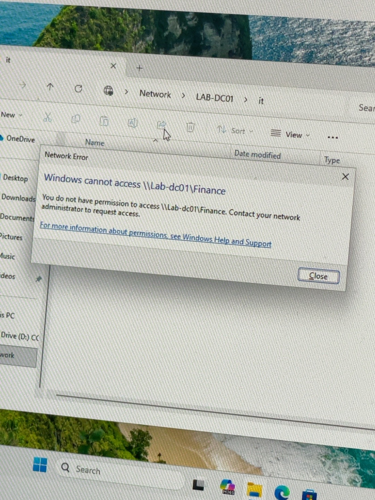

# Windows Server Enterprise Infrastructure Lab

**Self-directed home lab | October 2026 | One completed project**

Built and tested an isolated, virtualized Windows domain to practice identity administration, workstation policy, domain authentication, and department-based file access. The environment contains one Windows Server domain controller (`LAB-DC01`) and one domain-joined Windows 11 workstation (`LAB-PC01`) on an internal VirtualBox network.

> **Scope:** Educational lab, not production infrastructure. This public repository contains **documentation and screenshots, not VM disk images or credentials**. The original environment is privately backed up as two OVA exports; successful import/restore testing has **not** yet been confirmed.

## At a glance

| Area | Implementation | Validation |
| --- | --- | --- |
| Virtualization | Two Oracle VirtualBox virtual machines, isolated `AD-LAB` internal network | Both VMs used together during lab testing |
| Identity & DNS | AD DS + DNS, `corp.example.test`, departmental OUs, user accounts and groups | Domain discovery, join and user authentication |
| Workstation policy | `GPO_Corp_Workstation_Security` linked to `Corp-Workstations` | `gpresult`; `InactivityTimeoutSecs = 600`; observed auto-lock |
| File services | `IT`, `HR`, `Finance` SMB shares on server | `Get-SmbShare` returned all three |
| Authorization | Per-department NTFS **Modify**; SMB **Change**; admin access retained | Share ACLs verified with `Get-SmbShareAccess` and access tests |
| Negative testing | Cross-department attempts to access shares | Windows Access Denied for Marcus and Sarah; David reported equivalent results |

## Network architecture

```text
                          Oracle VirtualBox
                    Internal Network: AD-LAB
                         192.168.10.0/24

  +--------------------------------+      +--------------------------------+
  | LAB-DC01                       |      | LAB-PC01                       |
  | Windows Server                 |      | Windows 11 (domain joined)     |
  | 192.168.10.10                  |<---->| 192.168.10.20                  |
  | AD DS / DNS                    |      | DNS: 192.168.10.10             |
  | corp.example.test              |      | Computer OU: Corp-Workstations |
  | SMB: IT / HR / Finance         |      | Domain user access testing     |
  +--------------------------------+      +--------------------------------+
```

For the architecture diagram and responsibilities, see [docs/ARCHITECTURE.md](docs/ARCHITECTURE.md).

## Active Directory design

```text
corp.example.test
├── Corp-Users (OU)
│   ├── IT (OU)       → Marcus Johnson → GG_IT_Staff
│   ├── HR (OU)       → Sarah Mitchell → GG_HR_Staff
│   └── Finance (OU)  → David (test user) → GG_Finance_Staff
└── Corp-Workstations (OU)
    └── LAB-PC01 → GPO_Corp_Workstation_Security
```

Organizational units organize objects and support delegation/policy targeting; security groups organize access permissions. The two concepts are not interchangeable.

## Build and configuration

1. Deployed Windows Server in VirtualBox; installed AD DS and DNS; promoted `LAB-DC01` as the domain controller for `corp.example.test`.
2. Created departmental OUs, test user accounts, and global security groups (`GG_IT_Staff`, `GG_HR_Staff`, `GG_Finance_Staff`).
3. Deployed Windows 11 as `LAB-PC01`, configured static network settings and DNS pointing at the domain controller, joined the domain and moved the computer to `Corp-Workstations`.
4. Configured a computer GPO setting **Interactive logon: Machine inactivity limit = 600 seconds**. Validated application and observed the workstation **lock** after inactivity (not user logoff).
5. Created `C:\CorpShares\IT`, `C:\CorpShares\HR`, and `C:\CorpShares\Finance` on `LAB-DC01` (an educational simplification; production would normally use a separate file server).
6. Disabled inheritance on the departmental folders, converted inherited ACLs, removed broad `CORP\Users` access and assigned each department's AD group NTFS **Modify**. Preserved SYSTEM and Administrators permissions.
7. Created SMB shares with each department group assigned **Change** and Administrators **Full**; removed broad `Everyone` entries.
8. Tested access and access denial by signing into `LAB-PC01` using the three test employee accounts.

Full configuration explanation: [docs/CONFIGURATION.md](docs/CONFIGURATION.md).

## Access control matrix

| Domain user | IT share | HR share | Finance share |
| --- | --- | --- | --- |
| Marcus (IT) | **Allowed** (folder opened) | Denied | Denied |
| Sarah (HR) | Denied | **Allowed** (`HR-Test` created) | Denied |
| David (Finance) | Denied* | Denied* | **Allowed*** |

\* David's equivalent successful results were reported during the lab; no dedicated screenshot is bundled. **Marcus's IT file creation was suggested but not screenshot-confirmed**. No claim is made that all nine read/write combinations were independently photographed.

**Why both permissions matter:** Access to a network share is bounded by the intersection of SMB share permissions and NTFS file-system ACLs. A group having SMB Change does not override restrictive NTFS permissions.

## Representative evidence

| Evidence | Screenshot |
| --- | --- |
| Three departmental SMB shares and access entries |  |
| IT ACL | [IT NTFS access entries](evidence/01_IT_NTFS_acl.jpeg) |
| HR ACL | [HR NTFS access entries](evidence/02_HR_NTFS_acl.jpeg) |
| Finance ACL | [Finance NTFS access entries](evidence/03_Finance_NTFS_acl.jpeg) |
| HR file write test |  |
| Cross-department restriction |  |

A complete labeled image index and validation notes are in [docs/EVIDENCE.md](docs/EVIDENCE.md) and [docs/VALIDATION.md](docs/VALIDATION.md).

## Troubleshooting highlights

- Confirmed client IP/DNS and domain connectivity with `ipconfig /all`, `ping`, `nslookup`, and `nltest /dsgetdc:corp.example.test`.
- Joined and renamed the Windows client; initial post-join rename warning required checking actual domain membership/hostname after restart rather than assuming failure.
- Investigated failed user logons using AD account status, username formats and Windows Security event logs (including Event ID **4625**).
- Distinguished domain user sign-in from local workstation sign-in and verified a successful domain identity with `whoami`.
- Validated computer policy with `gpresult` and the `InactivityTimeoutSecs` registry value, followed by an observed lock-screen test.

Details: [docs/TROUBLESHOOTING.md](docs/TROUBLESHOOTING.md).

## Reproduce or review

The documentation describes the sequence and settings, but it is **not** an unattended, one-command provisioning system. Rebuilding requires licensed/evaluation Windows installation media, Oracle VirtualBox, manual Active Directory configuration and test accounts you create yourself. See [docs/CONFIGURATION.md](docs/CONFIGURATION.md).

The optional [scripts/ReadOnly-LabVerification.ps1](scripts/ReadOnly-LabVerification.ps1) is a **new read-only convenience script supplied with this repository**, not an artifact claimed to have been run during the original build. It lists share definitions and ACLs on the server; it does not create or modify resources.

## Security and publishing

This repo intentionally excludes `.ova`, `.vdi`, `.vbox`, ISO images, Active Directory database contents, exports of secrets, passwords, recovery keys and other sensitive system state. See [docs/SECURITY.md](docs/SECURITY.md). The lab OVA exports are maintained **privately**; exporting is not proof of a restorable backup until a separate import test succeeds.

## Interview summary

> I built a two-VM Windows Server infrastructure lab with AD DS and DNS, then joined a Windows 11 client to a test domain. I organized employees into departmental OUs and groups, deployed a 10-minute workstation inactivity-lock GPO, and configured IT, HR and Finance shares using both NTFS and SMB permissions. I tested successful access and cross-department denials from domain employee accounts, and used PowerShell and security logs to troubleshoot authentication. This was an isolated home lab rather than a production deployment.

[Interview notes](docs/INTERVIEW_NOTES.md) · [Testing methodology](docs/VALIDATION.md) · [Security considerations](docs/SECURITY.md)
