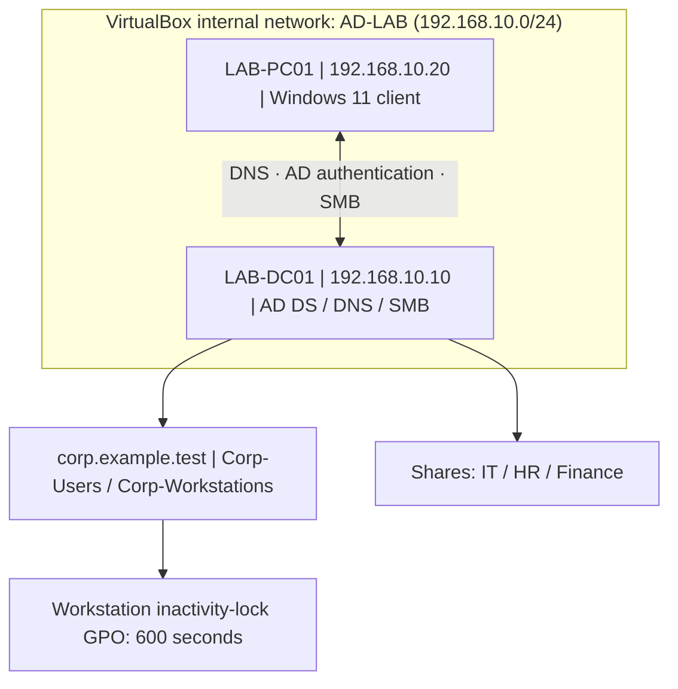

# Architecture and design

## Topology

The VirtualBox network is deliberately isolated. The Windows client uses `192.168.10.10` as its DNS server so it can resolve the AD domain and discover a domain controller. No internet gateway was required for this lab network.

## Roles and systems

| Component | Role |
| --- | --- |
| LAB-DC01 | First/only domain controller for `corp.example.test`, DNS, group policy configuration and educational SMB file-share host |
| LAB-PC01 | Domain-joined Windows 11 client used for authentication, GPO validation and authorization testing |
| Corp-Users | Parent OU holding departmental IT, HR and Finance OUs |
| Corp-Workstations | Computer OU to which workstation security GPO is linked |
| GG_*_Staff | Department security groups that receive access-control permissions |

## Design tradeoffs

- One domain controller is enough for a demonstration; it has no AD failover/high availability.
- Using the domain controller as an SMB file server is convenient for a small lab, **not** an ideal production separation of duties.
- Individual user access is assigned via groups rather than per-user ACEs, allowing membership changes without rewriting folder permissions.
- Inactivity locking reduces unattended-session exposure; it **does not log off users**.
- SMB share-level permissions and NTFS file permissions are separate; both affect effective network access.
